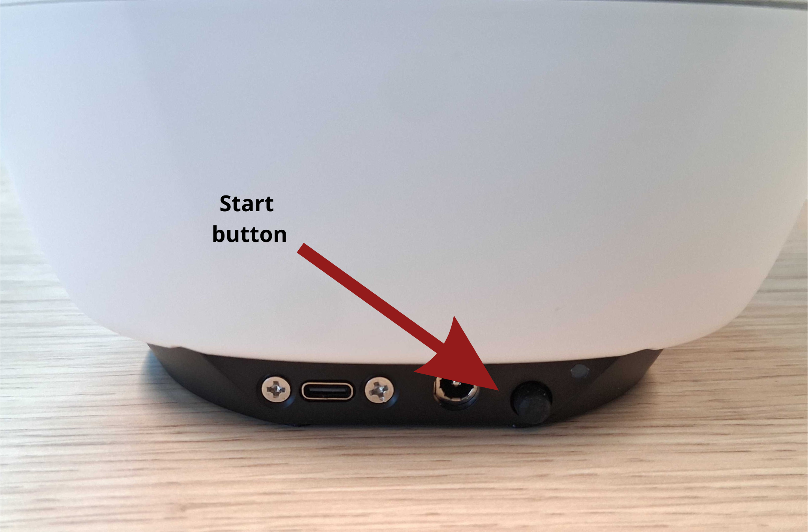

Getting started with the Reachy Mini
=================================================

Installation Linux User
----------------------------

If you're a Linux user, follow the official install guide:
 
- `Linux Installation Guide <https://huggingface.co/docs/reachy_mini/SDK/installation#-linux-users>`_

GStreamer installation
----------------------

Install GStreamer according to your platform:
 
- `GStreamer Setup Guide (Linux) <https://huggingface.co/docs/reachy_mini/SDK/gstreamer-installation?gstreamer-install=Linux>`_

Starting up the Reachy Mini
-----------------------------

To start up the Reachy Mini, push the button at the back of the black foot. The light turns green. The robot should make some soft motor noises, after which the robot is usually ready for connection. It does not make a custom noise to indicate that it has started up.

Important: the green light does not automatically mean the robot is turned on. The light is also green when the robot is charging. It is only on when the button is pushed in.

IP addresses of the Reachy Minis are found on the bottom of the robot.

Reachy Mini control
-----------------------------

For adjusting settings on the Reachy Mini, run `sic_applications\demos\reachy_mini\demo_reachy_mini_settings.py <https://github.com/Social-AI-VU/sic_applications/blob/main/demos/reachy_mini/demo_reachy_mini_settings.py>`_. It can be used for setting the volume and putting the robot into rest position. The robot should always be in rest position when idle.